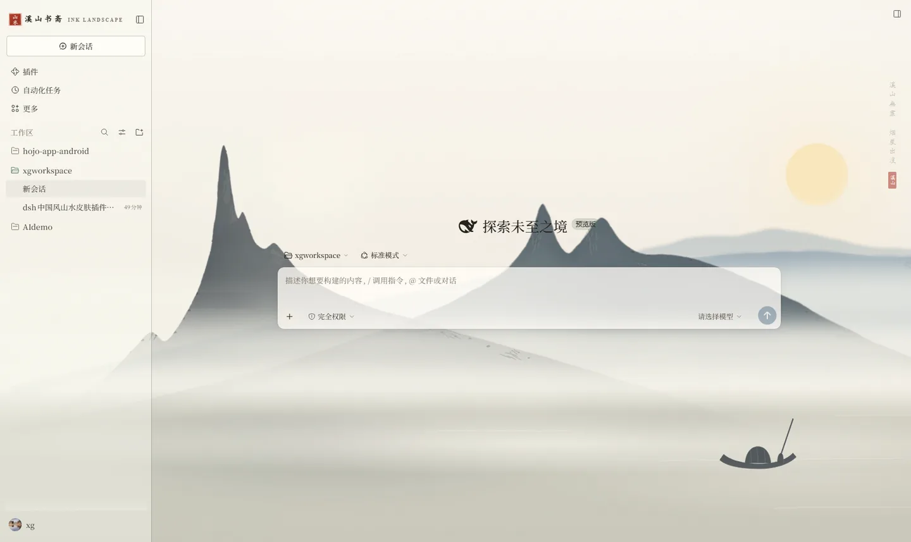
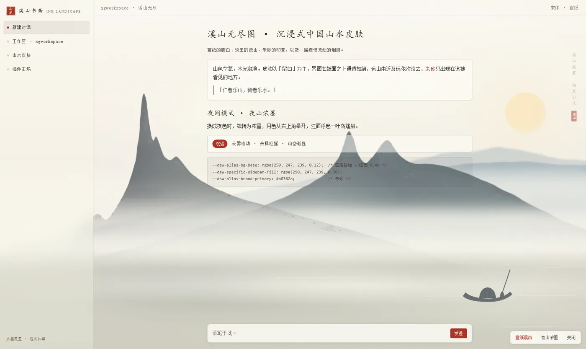
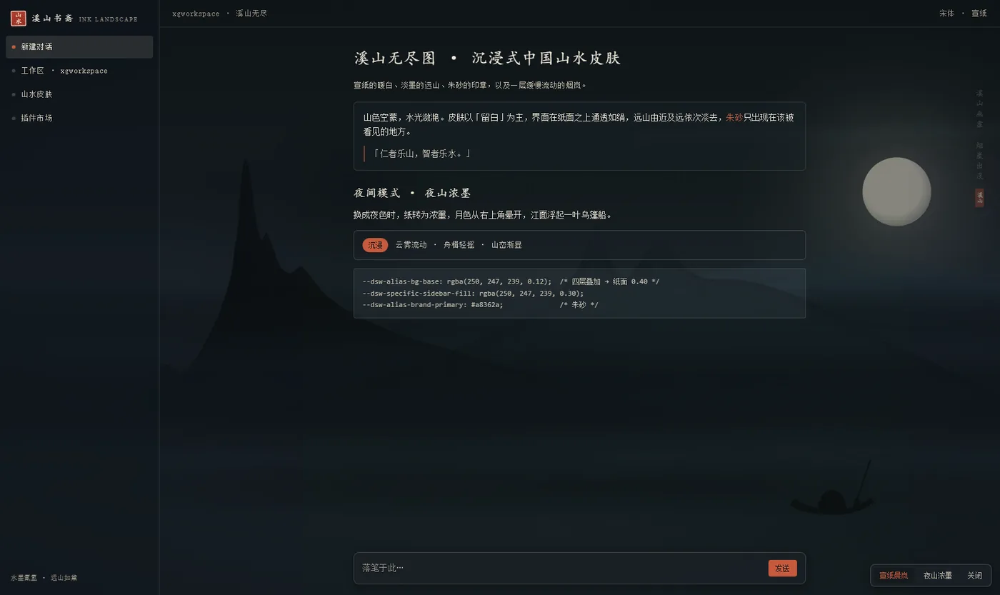
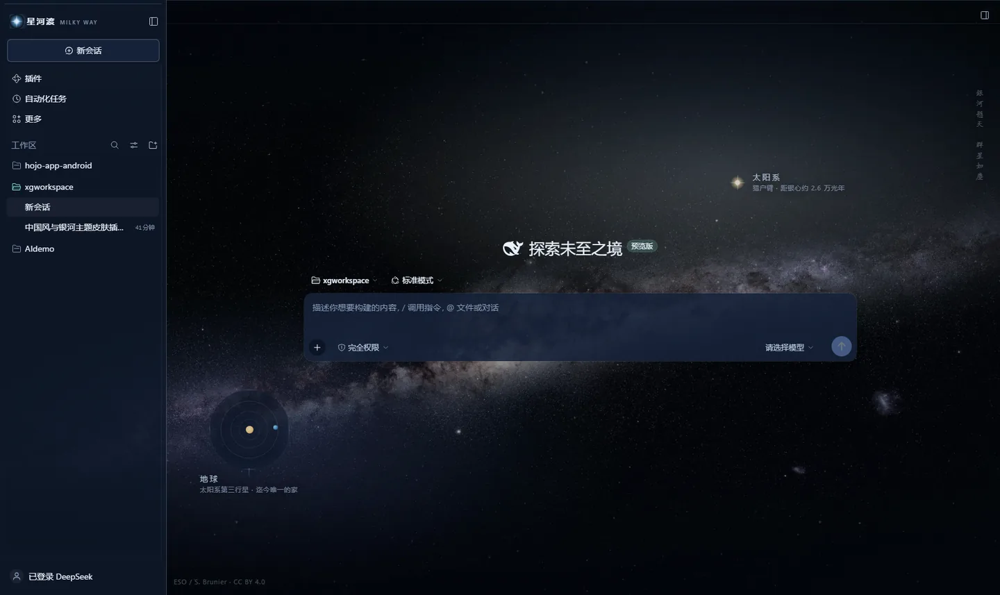
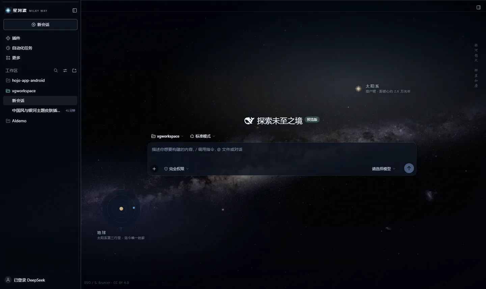
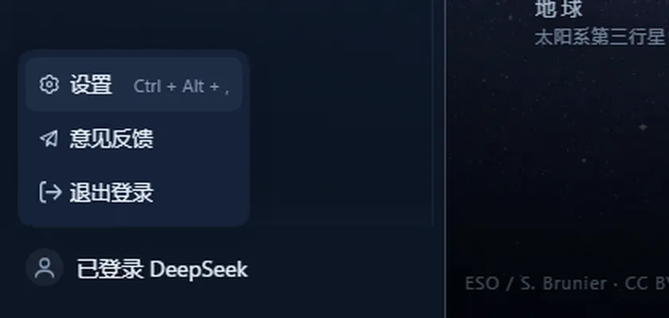
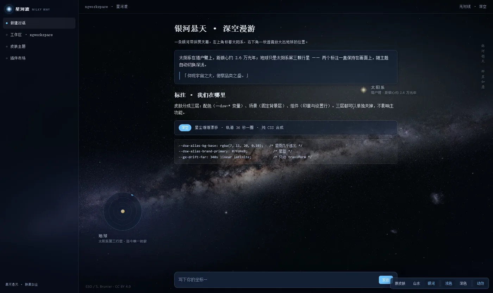
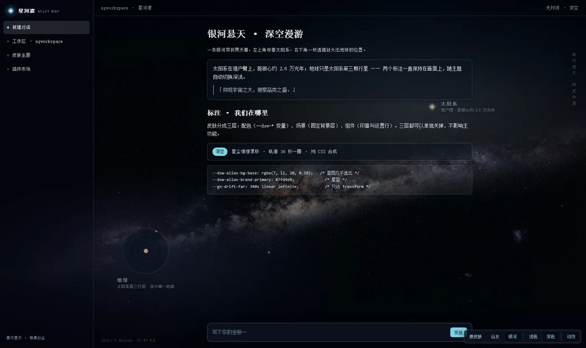
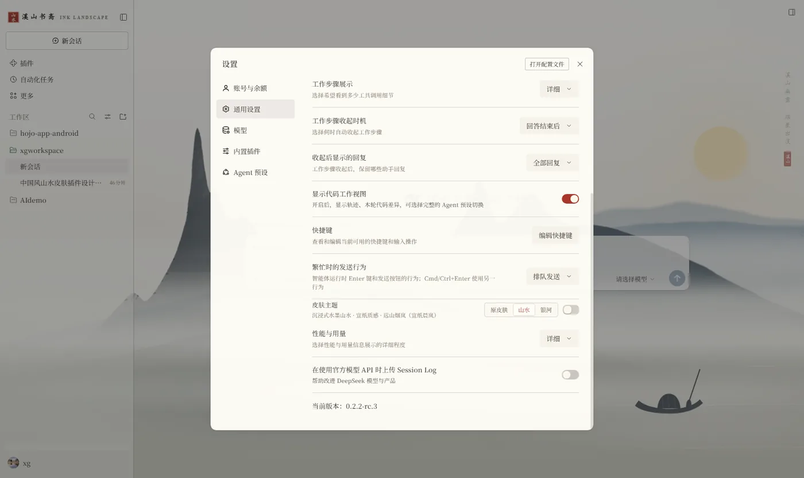
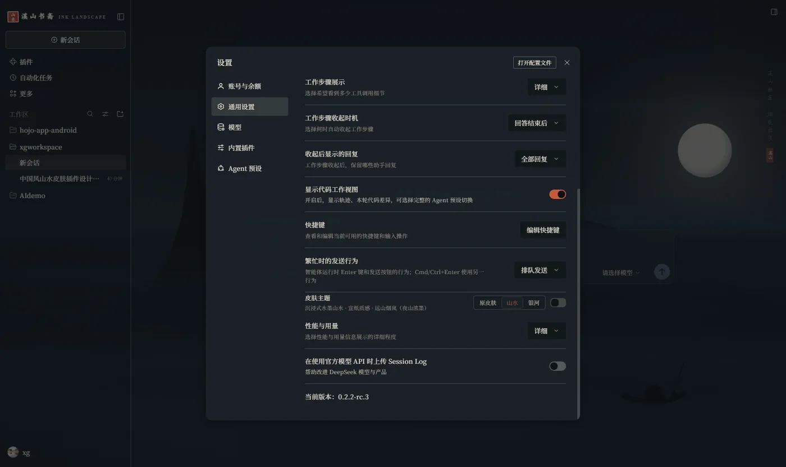

# dsh-ink-landscape · 溪山书斋 / 星河渡

为 [DeepSeek Harness](https://github.com/deepseek-ai)（DSH）做的**沉浸式皮肤插件**：
两套可选主题 —— 宣纸水墨的**山水**，和以真实银河照片为底的**星空** —— 都做到「画面在界面之下流动，而不是贴一张壁纸」。

[](LICENSE)
[](NOTICE.md)
[](#兼容性)
[](package.json)



---

## 一、这是什么

DSH 的界面完全由一套 `--dsw-*` 设计令牌驱动。这个插件不去改组件，而是：

1. 用官方接口 `theme.overrideTokens()` 叠一整层令牌（约 160 个），把「纸/墨/朱砂」或「深空/星蓝」灌进界面；
2. 在 `html` 上挂一层**全屏场景画布**（`#dsh-ink-scene`，`z-index:-1`、`pointer-events:none`），山水/银河从所有面板底下透上来；
3. 用 `slots` 顶掉侧栏品牌位（印章 + 题字）、在「设置 → 通用」里加一行开关。

**没有构建链**：`lib/client.js` 就是最终产物，手写成 DSH 的 lazy-CJS bundle 形态，改完保存即生效。

## 二、两套皮肤

| | 山水 · 溪山书斋 | 银河 · 星河渡 |
| --- | --- | --- |
| 浅色 | 宣纸晨岚（远山烟岚 + 朱砂印章） | 暮色深空 |
| 深色 | 夜山浓墨（月下一叶乌篷船） | 子夜银河（真实暗尘丝缕） |
| 字体 | 正文宋体、标题楷体 | 无衬线深空风 |
| 画面 | 手写 SVG 三远法构图 → 烘焙位图 | ESO/S. Brunier 全景照片裁切调色 |
| 标注 | 竖排题字 + 收藏印 | 太阳系 / 地球（放大镜） |

| 山水 · 浅色 | 山水 · 深色 |
| --- | --- |
|  |  |

| 银河 · 浅色 | 银河 · 深色 |
| --- | --- |
|  |  |

「原皮肤」永远是一键可回：插件把所有改动都放在可撤销的层里，切回原皮肤后 DSH 逐像素回到出厂状态（场景、令牌层、品牌位、外壳标记全部清零）。

### 更多截图

| 设置 → 通用 里的开关行 | 账户弹层（0.2.2 修复后） |
| --- | --- |
|  |  |

| 银河 · 浅色（离线预览页） | 银河 · 深色（离线预览页） |
| --- | --- |
|  |  |

| 设置面板 · 浅色 | 设置面板 · 深色 |
| --- | --- |
|  |  |

## 三、安装

需要：DSH 桌面版（web 前端）+ Node.js ≥ 20 + pnpm。

### 方式 A：直接从 GitHub 装（推荐）

DSH 的 `desktop` profile 由 Electron 管理，`dsh plugin --profile desktop add` 会被拒绝，
所以直接在该 profile 目录里用 pnpm 装，再把包装进 `dsh.profile.bundles`：

```bash
cd "$DSH_HOME/profiles/desktop"          # Windows 默认 %USERPROFILE%\AppData\Roaming\dsh 之外，看你的安装
pnpm add "github:devwangxiaogang/dsh-ink-landscape#v0.2.2"
```

然后编辑同一个 `package.json`，在 `dsh.profile.bundles` 末尾加一行（**这一步不能少**，
loader 只会挂载列在这个数组里的包）：

```jsonc
"dsh": { "profile": { "bundles": [ /* … */, "dsh-ink-landscape" ] } }
```

**重启 DSH**，插件就出现在「设置 → 通用 → 皮肤主题」。

升级：把 `#v0.2.2` 换成新 tag 再 `pnpm add` 一次即可（或用 `pnpm update dsh-ink-landscape`）。

### 方式 B：克隆到本地再 link（改代码时用）

```bash
git clone https://github.com/devwangxiaogang/dsh-ink-landscape.git
cd dsh-ink-landscape
node tools/profile-link.mjs install --profile desktop
```

`install` 做的事全部可逆（会自动备份 `package.json`）：

1. 在 profile 的 `dependencies` 里加 `"dsh-ink-landscape": "link:<本仓库路径>"`；
2. 在 `dsh.profile.bundles` 里追加 `dsh-ink-landscape`；
3. 建 `node_modules/dsh-ink-landscape` 目录联接。

改 `lib/client.js` 保存即生效（宿主每次请求都读盘），只有改 `package.json` / 换包才需要重启。

### 卸载

```bash
cd "$DSH_HOME/profiles/desktop"
pnpm remove dsh-ink-landscape          # 方式 A
node tools/profile-link.mjs uninstall --profile desktop   # 方式 B
```

两种方式都记得把 `dsh.profile.bundles` 里那一行删掉（脚本会自动删，手动装的要自己删），
然后重启 DSH。皮肤卸载后 DSH 完全回到出厂外观，不留任何痕迹。

<details>
<summary>手动安装（不跑脚本、不联网）</summary>

把仓库下载/解压到任意目录，然后：

```jsonc
// %DSH_HOME%/profiles/<profile>/package.json
{
  "dependencies": {
    "dsh-ink-landscape": "link:D:/path/to/dsh-ink-landscape"
  },
  "dsh": {
    "profile": {
      "bundles": [/* … 其它插件 … */, "dsh-ink-landscape"]
    }
  }
}
```

再建联接（Windows，管理员或开发者模式）：

```powershell
New-Item -ItemType Junction `
  -Path "$env:DSH_HOME\profiles\desktop\node_modules\dsh-ink-landscape" `
  -Target "D:\path\to\dsh-ink-landscape"
```

</details>

## 四、使用

* **切换皮肤**：设置 → 通用 → 皮肤主题 → `原皮肤 / 山水 / 银河`。
* **动效开关**：同一行右侧的圆点（默认开）。关掉只留静态画面；系统设了「减少动态效果」时自动压掉。
* **跟随明暗**：皮肤自己组两套令牌（light / dark），DSH 切明暗时画面与配色一起换，不需要重新选皮肤。
* **偏好存放**：`localStorage` 的 `dsh-ink-landscape:skin` 与 `:motion`，不写入 DSH 设置，不会和主题设置打架。

## 五、实现要点（踩过的坑）

### 为什么不用 `ctx.theme.register()`

注册自定义主题会把偏好 id 写进设置 scope，而 scope 只认自己那份合法 id 列表，`adopt()` 一到就把它改回去 —— 在当前版本无法常驻。
`theme.overrideTokens(source, { light, dark })` 是官方给的**叠加层**：不写偏好、不影响用户自己的主题选择、跟随 `theme/change` 重算。所以皮肤是「跟着明暗走的叠加层」，而不是「抢走主题设置」。

### 为什么全屏底色是半透明的

shell 把 `--dsw-alias-bg-base` 画在**四层**全屏元素上（`body` → frame → root → tabHost），合成不透明度 = `1-(1-a)^4`：

| alpha | 合成 | 观感 |
| --- | --- | --- |
| 0.87 | 1.00 | 画面完全看不见（出厂值） |
| 0.24 | 0.67 | 夜色里山影若隐若现 |
| 0.12 | 0.40 | 宣纸上淡墨远山（浅色默认） |
| 0.20 | 0.59 | 夜色里山影更沉（深色默认） |

**沉浸感只留给画布，不留给正文**：对话框、设置面板、菜单另走近乎不透明的纸/玻璃层，遮罩也提到 0.40/0.56，正文永远读得清。

### 弹层与外壳要单独上色

* 弹出菜单的材质读 `--dsw-menu-surface-fill`（`--dsw-specific-menu` 只是它的别名）。只覆盖后者，浅色档会露出出厂的 `rgba(252,253,254,0.7)`，深空底上冒出一块白。
* 侧栏与顶栏是 shell 自己的 `div` / `header`，类名是 CSS-module 哈希，没有 `data-*`。所以运行时找到 `[data-sidebar-scrollport]` 的父元素与 `[data-window-drag="true"]`，打上 `data-ink-sidebar` / `data-ink-header`，再叠竖向 wash、边缘 hairline、天头的品牌色细线。

### 画面为什么是位图

山水画稿里有 24 处 SVG 滤镜（三条 `feTurbulence` + `feDisplacementMap` 铺满整幅山脊、11 个雾形模糊），每次加载都要在主线程重算、是首屏卡顿的主因。发布形态改成「绘图期烘焙、运行期只解码」：

```bash
node tools/bake-art.mjs all     # art/scene.svg → lib/assets/scene-{dawn,night}.webp + 三张星尘瓦片
node tools/bake-photo.mjs all   # art/galaxy-photo.html → lib/assets/galaxy-{light,dark}.webp
```

### 动效怎么做到不卡

全部只动 `transform` / `opacity`（合成器线程），零 `filter`、零 canvas、零 `requestAnimationFrame`：

| 层 | 动作 | 周期 |
| --- | --- | --- |
| 星尘·远 | `translate3d` 漂移 | 340 s |
| 星尘·近 | 反向漂移 | 190 s |
| 闪烁层 | 整层 `opacity` 呼吸 | 11 s |
| 流星 ×2 | 斜向流光，错开 | 13 s / 19 s |
| 山水云岚 | 两幅山体缓慢平移 + 雾带呼吸 | 42 s / 26 s |

修过的两处每帧开销：流星原来用 `filter: drop-shadow`（每帧重算滤镜）→ 把光晕画进第二层渐变；闪烁层加 `translate3d` 单独提层。

## 六、性能实测

无头 Edge（1680×1000，`tools/perf.mjs`，银河 + 动效全开）：

| 指标 | 结果 |
| --- | --- |
| 首屏长任务 | 1 次 65 ms（照片解码 + 首绘；Script 仅 15 ms） |
| 空闲 3 s 主线程 `TaskDuration` | 5–7 ms（≈2 ms/s） |
| Layout / 样式重算 | 0 / 3 次 |
| 运行时滤镜 | 0 |
| 运行时 SVG 节点 | 3（三个圆环，避免方角化） |
| 样式表 `<style>` | 1 |
| 场景挂载时机 | `requestAnimationFrame` → `requestIdleCallback`（不阻塞首屏） |

## 七、目录结构

```
dsh-ink-landscape/
├─ package.json            # dsh.client（platform: web, immediately）+ dsh.bundle.patch
├─ cordis.patch.yml        # 只 insert 自己一行
├─ lib/
│  ├─ index.js             # 宿主半：空 apply（让 loader 认这个包）
│  ├─ client.js            # 客户端半：唯一需要维护的脚本（手写 lazy-CJS bundle）
│  └─ assets/              # 烘焙好的位图（山水 2 张 / 银河 2 张 / 星尘 3 张）
├─ art/                    # 画稿工作区：scene.svg、galaxy-photo.html、galaxy-gen.mjs、调色板
├─ preview/                # 离线预览页（伪造 shell + 真实令牌，可脱离 DSH 调画面）
└─ tools/                  # 烘焙、截图、性能探针、profile 接入
```

## 八、开发

```bash
node tools/serve.mjs 54777
# → http://127.0.0.1:54777/preview/index.html?family=ink&scheme=dark
#   右下角的三选一开关等价于设置里那一行；改 client.js 刷新即可，不用重启 DSH
```

| 脚本 | 用途 |
| --- | --- |
| `tools/profile-link.mjs` | 接入 / 卸载 / 查看 profile 安装状态（写 package.json、bundles、junction，自动备份） |
| `tools/bake-art.mjs` | 烘焙山水底图与星尘瓦片：`dawn` / `night` / `tiles` / `all` |
| `tools/bake-photo.mjs` | 烘焙银河底图：把 ESO 照片按 `art/galaxy-photo.html` 的裁切调色渲染成 WebP |
| `tools/shot.mjs` | CDP 无头截图：`node tools/shot.mjs <url> <out.png> [waitMs] [w] [h] [light\|dark]` |
| `tools/shot-skin.mjs` | 给真实 shell 预置皮肤后截图 |
| `tools/probe-overlay.mjs` | 真实 shell 里「预置皮肤 → 执行动作 → 截图 + 回显可疑底色」（查发白/漏色特别有效） |
| `tools/probe-settings.mjs` | 打开设置并度量弹层底色、遮罩、稳定钩子、我们那一行是否渲染 |
| `tools/perf.mjs` | 首屏体检：boot marks / long tasks / 空闲增量 / 场景自省 |
| `tools/probe-file.mjs` | 对本地页面求值并回显 console / 异常 |

截图与探针都走 **headless Edge + CDP**，不需要 playwright（Windows 上 Edge 是系统自带的）。

## 九、素材与许可

* **代码**：[MIT](LICENSE)。
* **银河底图**：ESO/S. Brunier *The Milky Way panorama*（[eso0932a](https://www.eso.org/public/images/eso0932a/)），**CC BY 4.0**，本仓库对其做了裁切、旋转、调色与重编码（可复现于 `art/galaxy-photo.html`）。署名 `ESO / S. Brunier · CC BY 4.0` 常驻画面左下角，不可关闭；二次分发请保留。
* **山水底图与星尘瓦片**：本仓库原创（`art/scene.svg` + `art/galaxy-gen.mjs`），随代码 MIT。
* 本仓库**不打包**任何字体，只声明字体族；缺字体时回落到系统 `serif`。

细节与替换素材的步骤见 [NOTICE.md](NOTICE.md)。

## 十、兼容性

* 针对 **DSH desktop（web 前端）** 编写，`platform: "web"`；宿主半是空实现，所以不影响任何 host 侧能力。
* 只依赖 DSH 的公开客户端接口：`theme.overrideTokens` / `theme.getTheme` / `theme/change` / `slots.register` / `slots.inject`。
* 令牌名与 `data-*` 钩子取自当前版本的外壳；DSH 改版后若某处漏色，用 `tools/probe-overlay.mjs` 一跑就能定位。

## 十一、致谢

* [DeepSeek Harness](https://github.com/deepseek-ai) —— 插件与主题接口。
* [ESO](https://www.eso.org/) / Serge Brunier —— 那张让「星河」成立的全天照片。
* 山水部分的构图取自北宋「三远法」：高远、深远、平远各一层，留白处即水面。

---

如果这套皮肤让你的 DSH 顺眼了一点，欢迎点个 ⭐；想加自己的配色，改 `lib/client.js` 里的 `PALETTE` 即可。
